# Lab 2 - Teach Bob Your Way (the `.bob` folder: rules & skills)

> **Done with [Lab 1](./README.md)? Great - you've got the basics.** Now you'll do the thing that
> makes Bob *yours*: teach it your standards once, and give it reusable recipes - so it works your way
> automatically. All of this lives in a folder called **`.bob`**.
>
> **Remember Lab 1, Step 5?** You told Bob "make it look modern" - and you'd have to say that *every
> single time* you build a page. This lab fixes exactly that: you'll save that preference once, and
> Bob will apply it on its own.
>
> ~20-30 minutes · Keep working in the **same JSON formatter project** from Lab 1.

---

## The idea: so far you *asked*; now you *teach*

In Lab 1, Bob did what you asked, one request at a time. That's great - but you had to say it every
time.

Now you'll teach Bob two kinds of things that **stick**:

| Thing | Plain English | Lives in |
|-------|---------------|----------|
| **Rule** | A standing standard Bob follows *every time*, without you repeating it | `.bob/rules/` |
| **Skill** | A saved *recipe* Bob runs when the job matches - write once, reuse forever | `.bob/skills/` |

Both live in a folder called **`.bob`** in your project. (The Day-1 rules from Lab 1 still
apply - read every diff before you approve.)

---

## Part A - Teach Bob a standing rule (`.bob/rules/`)

> **What is a rule? (plain English)**
> A rule is like a team style guide pinned to the wall. You write it once, and Bob follows it on
> *every* job without being reminded. Rules live as plain files in `.bob/rules/`, and Bob reads them
> automatically at the start of every task.

### Step 1 - Create a rule (capture the look you asked for by hand in Lab 1)

1. Make sure you're in **Agent** mode (the `+` button at the bottom of the chat).
2. Paste this and press Enter:

   ```
   Create a rule file at .bob/rules/house-style.md.
   The rule: every HTML file in this project should use our house look - a centered card,
   generous spacing, a friendly font, soft colors, and big clear buttons (the same modern
   style we used on the JSON formatter). After you create it, confirm you'll follow it from now on.
   ```

3. Bob writes the rule file - **Approve** the change.

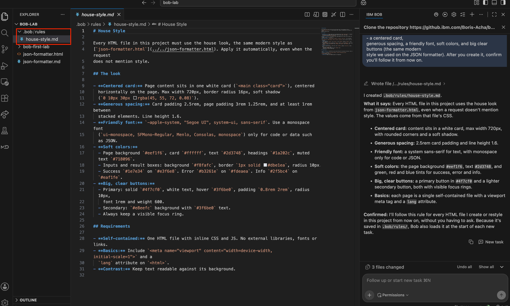

4. **Now reload Bob so it picks up your new rule.** A new rule (or skill) only takes effect after a
   window reload. You'll do this whenever you add a rule or a skill. Here's how:

   a. Click the **gear icon** (bottom-left of VS Code) → **Command Palette…** (or press
      **⌘ + Shift + P** / **Ctrl + Shift + P**).

      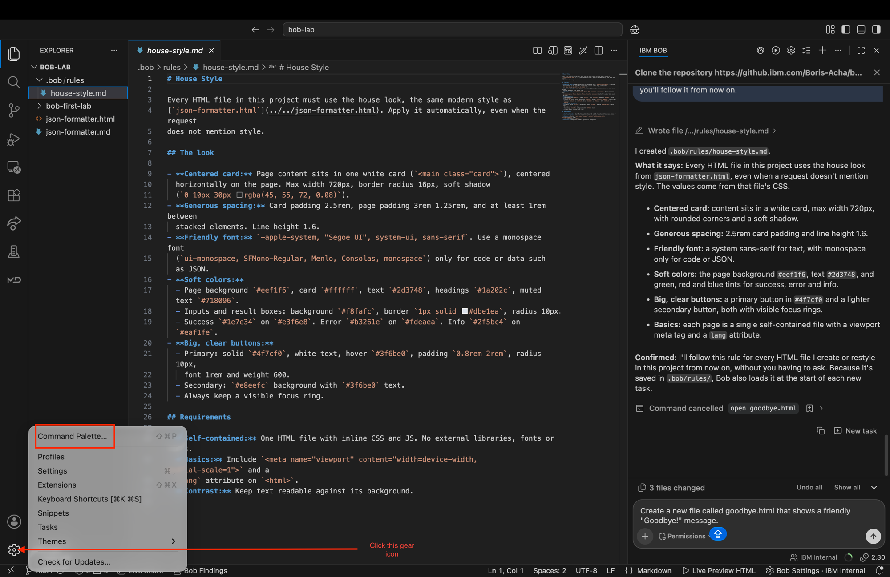

   b. Type **Reload** and choose **Developer: Reload Window** (the first option).

      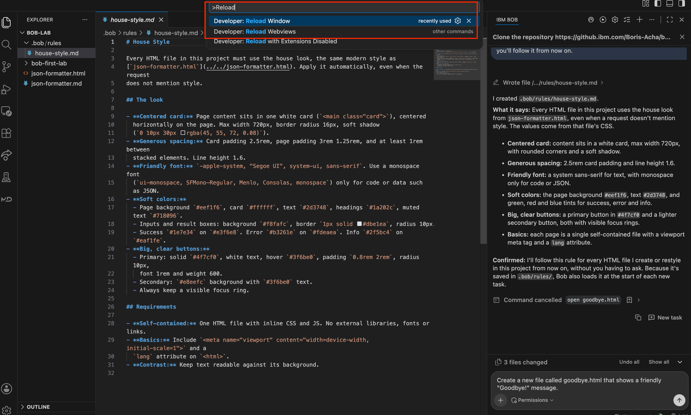

   c. The window reloads and Bob shows its "Hi, I'm Bob" welcome. **Click your recent task** under
      **Recent Tasks** to reopen the chat you were in.

      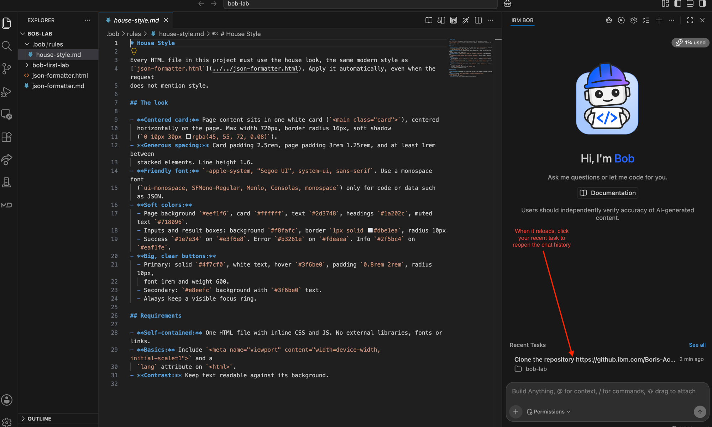

**Notice:** you didn't change any app code - you wrote down a *standard* for Bob to follow.

### Step 2 - Watch Bob follow the rule on its own

1. Back in **Agent** mode, paste:

   ```
   Create a new file called goodbye.html that shows a friendly "Goodbye!" message.
   ```

2. Read the change before approving, then **Approve**, and open `goodbye.html` in your browser
   (or ask Bob: `please open goodbye.html in my browser`).
3. **Look at it:** it already has the modern house look - the card, the font, the soft colors - even
   though you never mentioned style in this request. The rule did that. Bob even tells you so:
   *"You didn't mention style, but I applied the house look from .bob/rules/house-style.md anyway."*

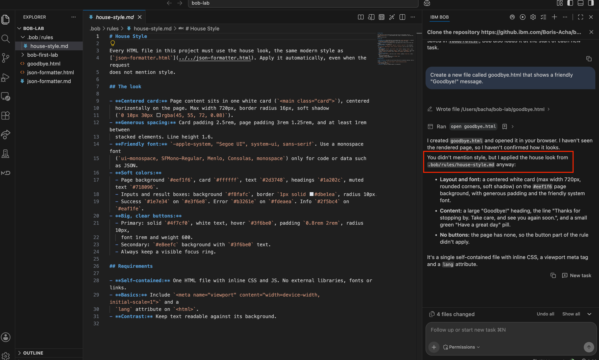

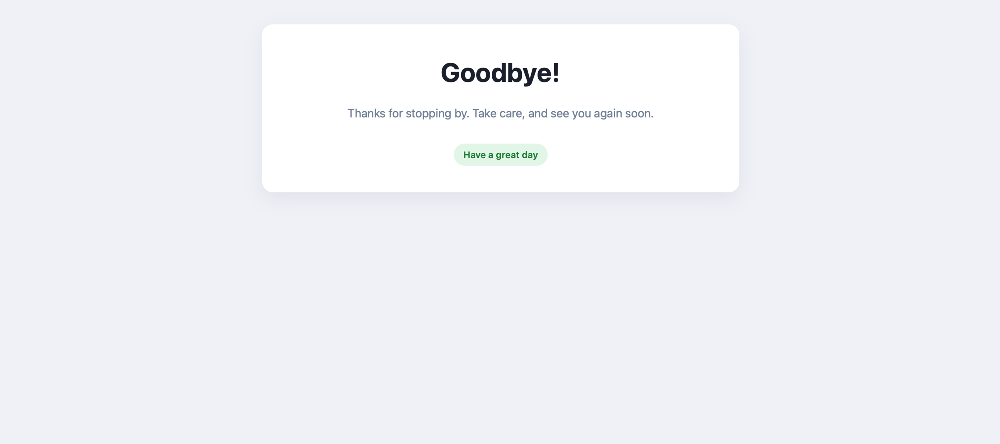

> **This is the payoff from Lab 1, Step 5.** Back then you asked for the modern look by hand, every
> time. Now it's a rule - Bob applies it automatically on every page. That's the whole point of rules.

**You just learned:** *rules in `.bob/rules/` are always-on standards. Bob follows them on every
task, without you repeating yourself.*

---

## Part B - Give Bob a reusable skill (`.bob/skills/`)

> **What is a skill? (plain English)**
> A skill is a *saved recipe*. Instead of typing the same multi-step request over and over, you write
> the steps down once as a skill, and Bob runs that recipe whenever the job matches. Skills live in
> `.bob/skills/<name>/SKILL.md`.

### Step 3 - Create a skill

1. Still in **Agent** mode, paste this:

   ```
   Create a skill at .bob/skills/new-page/SKILL.md.
   Use this format: start with frontmatter containing a "name" and a "description", then the steps.
   - name: new-page
   - description: Use when the user wants to create a new web page in this project.
   Steps the skill should follow:
   1. Ask me for the page title first.
   2. Create a self-contained HTML file named after the title (lowercase).
   3. Follow our .bob/rules/house-style.md look.
   4. Add a visible <h1> with the title and a footer that says "JSON Tools project".
   ```

2. Read it and **Approve**.

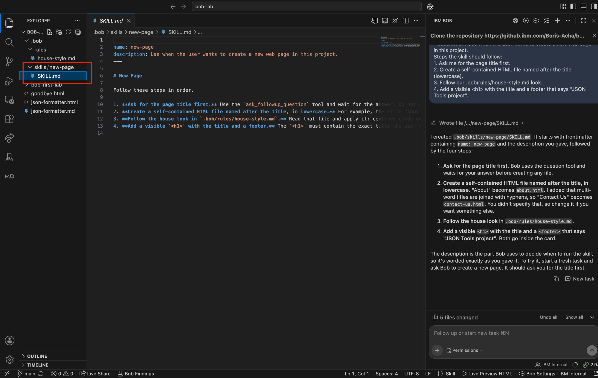

**Notice the two required pieces:** a **name** and a **description**. The description is how Bob
decides when to use the skill - *a skill with no description is ignored.*

### Step 4 - Reload, confirm the skill is active, then use it

1. **Reload Bob** so it picks up your new skill - the same way you did after creating the rule in
   Part A, Step 1 (gear icon → Command Palette → **Developer: Reload Window** → click your recent task).

2. Confirm Bob sees it: click the **gear icon** at the **top-right of the Bob panel** → **Skills**.
   Find **new-page** in the list. Notice its **Scope is Workspace** (it only applies to this project),
   and its **Active toggle** is on (new skills are active by default).

   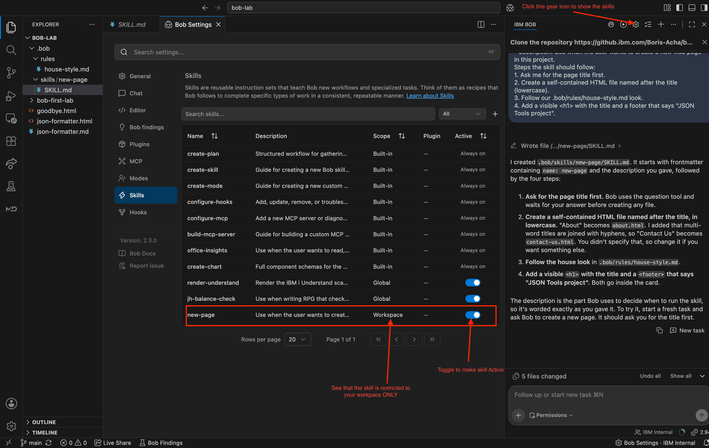

   > **Workspace vs Global skills.** The skill you just made is **Workspace** scope - it lives in this
   > project's `.bob/skills/` and only works here. Want a skill available in *every* project? Make it a
   > **Global** skill: exact same file and format, just put it in **`~/.bob/skills/<name>/SKILL.md`**
   > (your home folder) instead of the project's `.bob/skills/`. Workspace skills are great for a
   > project's standards; global skills are great for your personal toolkit. (Rules work the same way:
   > `.bob/rules/` is per-project, `~/.bob/rules/` is global.)

3. Now use it. Start a **fresh task** (the **`+`** at the top), make sure you're in **Agent** mode,
   and paste:

   ```
   Create a new page called About.
   ```

4. Watch what happens: Bob recognizes this matches your **new-page** skill, so it **asks you for the
   title first**, then builds the page following your recipe *and* your house-style rule.

   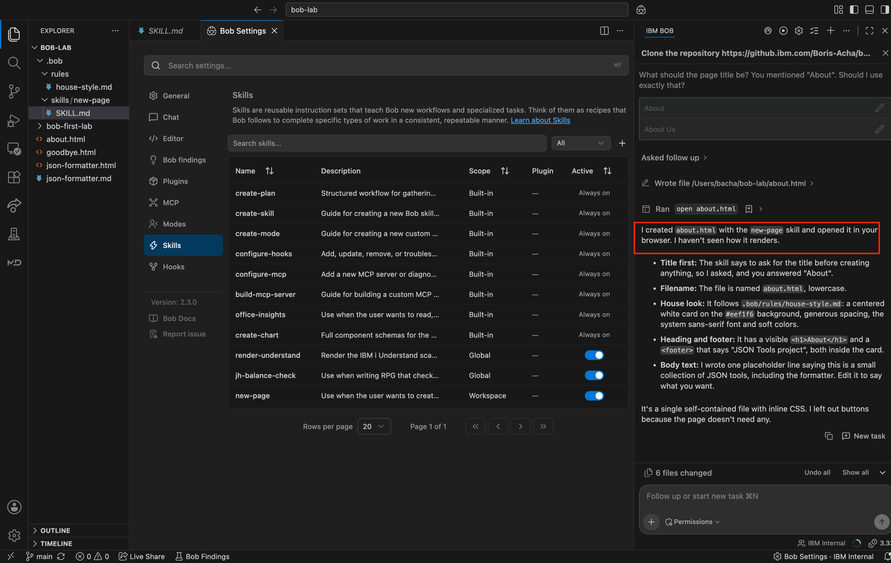

5. Answer the question, **Approve**, and open the file to see it followed the recipe.

**You just learned:** *skills in `.bob/skills/` are reusable recipes. Bob picks the right one based
on its description and follows your steps - every time.*

---

## Peek inside `.bob` (30 seconds)

In the file list on the left, open the **`.bob`** folder. You'll see:

```
.bob/
├── rules/
│   └── house-style.md     ← your standing standard
└── skills/
    └── new-page/
        └── SKILL.md       ← your reusable recipe
```

They're just **plain files**. Nothing magic. You can read them, edit them, and they travel with
your project in version control - so your whole team gets the same standards and recipes.

> **Bonus - `AGENTS.md`:** there's also a file called `AGENTS.md` you can put at your project's root.
> Think of it as your project's front-page standards - Bob loads it automatically too. Rules and
> `AGENTS.md` do a similar job; use whichever fits.

---

## You did it - and here's the payoff

You just taught Bob to work *your* way: a standing **rule** and a reusable **skill**, both living in
the `.bob` folder, both travelling with your project.

That means your whole team can share one set of standards and recipes. Everyone's Bob behaves the
same way - follows the same style, scaffolds pages the same way - without anyone repeating themselves.
You stop telling Bob the same things over and over, and you start *teaching it once*.

That's the difference between using Bob and **making Bob yours**.

---

## Recap - what you now know

- **Ask / Plan / Agent** modes (Lab 1)
- **Approvals, the diff, rollback** - you're always in control (Lab 1)
- **Rules** (`.bob/rules/`) - always-on standards Bob follows automatically
- **Skills** (`.bob/skills/`) - reusable recipes Bob applies when they match
- **Reload the window** after adding a rule or skill so Bob picks it up
- **`.bob`** is just a folder of plain files you version-control with your project, so your whole team shares them

That's everything you need to be productive with Bob - and to make it work your team's way.

---

## Explore more (optional - for the curious)

You've learned the core of Bob. There's more under the hood, in **Bob Settings** (the **gear icon** at
the top-right of the Bob panel). You don't need any of this for day-to-day work, but here's what each
one is so nothing's a mystery.

### Modes

Beyond **Ask / Plan / Agent**, you can build your own **custom modes** tuned to a workflow - for
example a "review only" mode, or a "docs writer" mode. Each mode decides which tools Bob may use.

### MCP (Model Context Protocol)

**MCP** lets Bob connect to **external tools and data sources** - APIs, databases, documentation -
so it can do more than just read your project files. Think of it as plugging Bob into the rest of your
systems. Each MCP server shows as Connected or Disconnected, and can be Global or per-workspace.

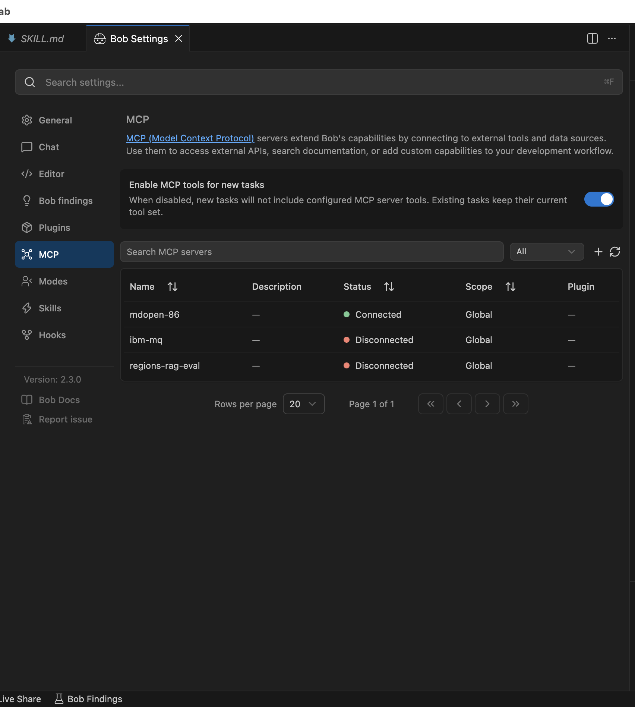

### Plugins

A **plugin** is a packaged bundle of skills, modes, and MCP connections that adds a whole capability
at once - instead of wiring each piece by hand. There's a **catalog** of approved plugins you can
browse and install (Jira, Confluence, Chrome DevTools, and more).

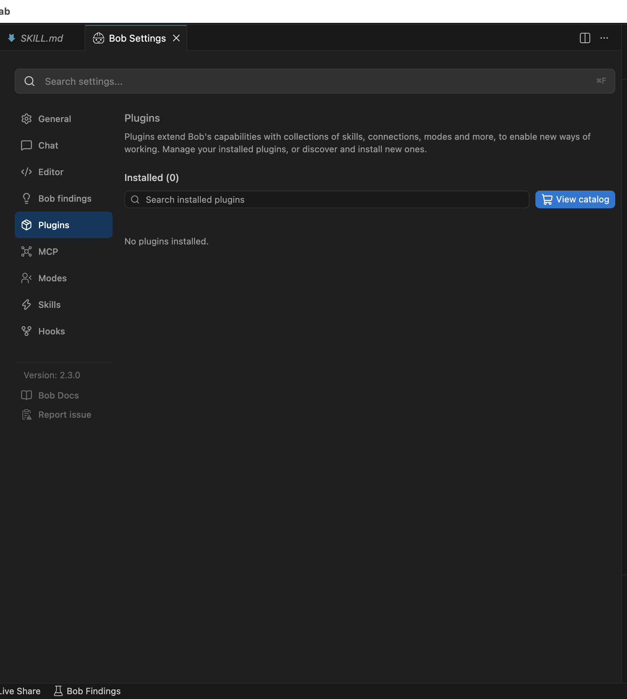

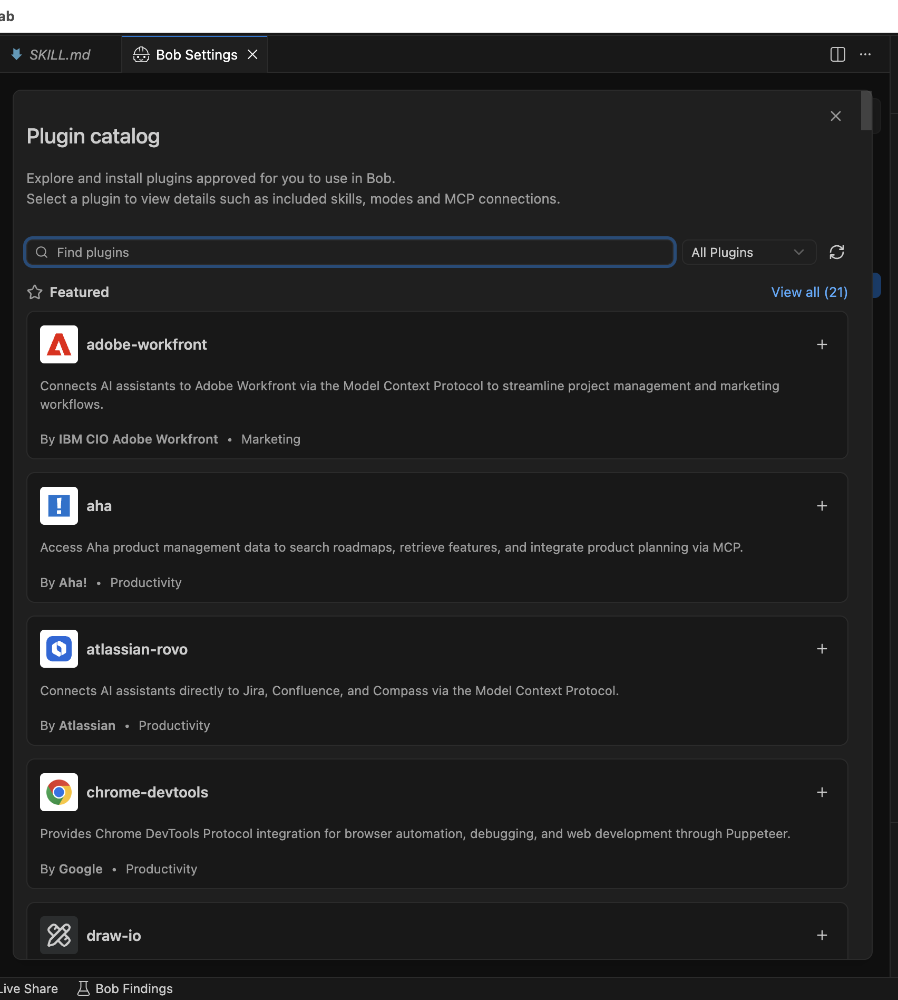

### Hooks

A **hook** runs your own shell command (or sends an event) **automatically at a key moment** in a Bob
session - for example *before a commit* or *after Bob edits a file*. It's handy for enforcing a check
without having to remember it. Hooks can be **Global** (every workspace) or **Workspace** (just this
project), the same Global-vs-Workspace idea you saw with skills.

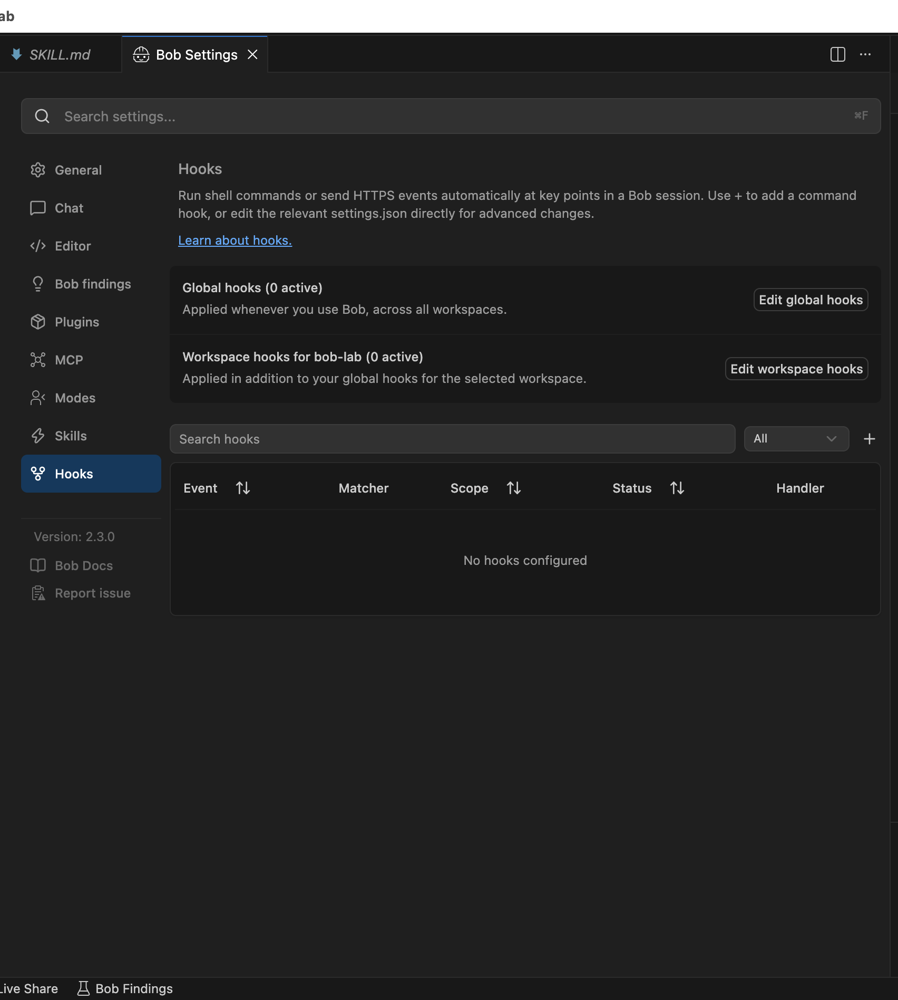

For how to set any of these up, see **Bob Docs** (the link at the bottom of Settings).
