# Lab 1 - Your First Hour with Bob

> **New to AI coding assistants, or just skeptical of them? This lab is built for exactly that - no
> experience needed.** In about 40 minutes you'll use Bob to build a real dev tool from scratch: a
> **JSON formatter and validator**. You'll plan it, build it, style it, and extend it, all by talking
> in plain English and approving every change yourself. The tool is really just the vehicle - what
> you'll walk away with is how to put Bob to work and stay in control the whole time.
>
> ~30-45 minutes · No setup - just Bob and a browser you already have.

---

## Before you start - open your workspace

You need just a few things:

1. **Open VS Code with IBM Bob.** (This lab was written for **Bob IDE version 2.3+** - you can check
   your version at the bottom of **Bob Settings**.)
2. **Open a folder to work in.** In VS Code: **File → Open Folder…**, then create or pick an empty
   folder (for example, a new folder called `bob-lab` on your Desktop) and open it. This is where your
   work will live.
3. **Open the Bob panel** - click the **Bob icon** at the top right of the window so the chat opens.
4. **Have any web browser ready** - Chrome, Edge, Safari, whatever you use.

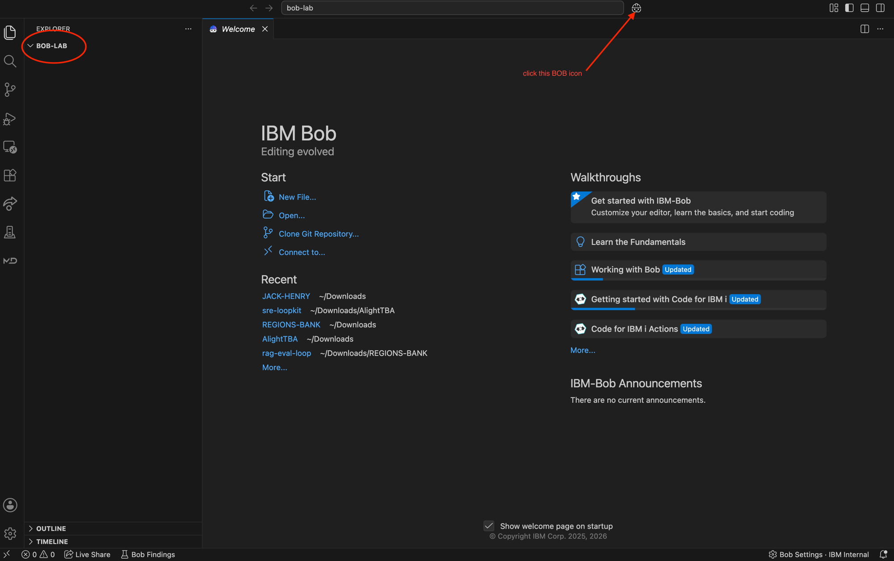

> **New to VS Code? Totally fine.** Opening a folder is just like opening one anywhere else:
> **File → Open Folder…**, pick a folder, done. That empty folder is your workspace for this lab.

---

## Start here - get the lab onto your machine

This lab lives on a public GitHub page, but **don't worry if you've never used GitHub** - think of that
page as nothing more than a download link. There are two easy ways to get it. Pick whichever you like.

### Option A - Just download it (simplest)

1. Open the lab page: **https://github.com/baacha123/bob-first-lab**
2. Click the green **Code** button, then **Download ZIP**.
3. Unzip it. Then in VS Code: **File → Open Folder…** and open the unzipped **bob-first-lab** folder.

That's it - no GitHub account, no commands.

### Option B - Let Bob grab it for you

With VS Code and Bob open on an empty folder, paste this into the Bob chat and press Enter:

```
Clone the repository https://github.com/baacha123/bob-first-lab into this folder,
then open its README.md and tell me how to start Step 1.
```

Bob pulls it down and opens this guide - and that's you using Bob for the very first time.

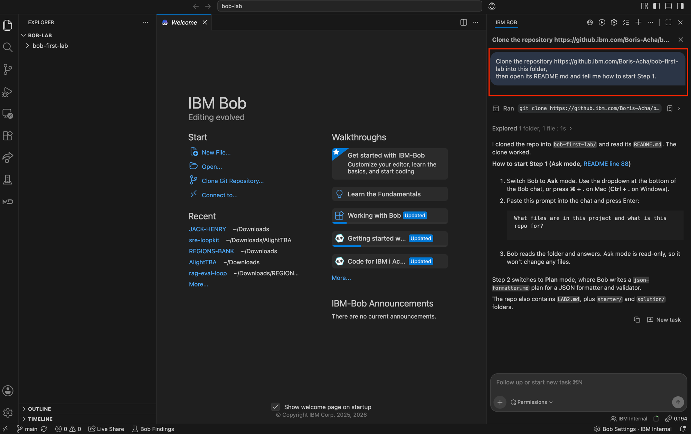

**Either way:** once the **bob-first-lab** folder is open in VS Code with the Bob panel showing, you're
ready for Step 1.

---

## Day 1 rules (read this first - 20 seconds)

A few ground rules so your first experience goes well:

- **Never paste secrets.** No passwords, API keys, tokens, or real customer data in the chat. Ever.
- **Read every change before you approve it.** Treat Bob like a teammate whose code you still review.
- **Work in small steps.** One small change at a time - not one giant request.
- **If a change goes wrong, don't fight it.** Reject it or undo it, then rephrase. Don't argue with it for 10 turns.
- **You own what you keep.** Bob helps; you're still responsible for the code you accept.

---

## What is Bob? (the 10-second version)

Bob is a smart teammate that lives inside your editor. You type what you want in plain English, and
Bob does the work - it reads code, writes code, and runs it for you.

But it does **not** go rogue. Before Bob changes anything, it shows you what it's about to do and
waits for your **OK** (you'll see exactly how in Step 1). You are always the boss.

---

## The one idea to hold onto: Bob has 3 "modes"

Think of them as three hats Bob can wear:

| Mode | What it does | Can it change your files? |
|------|--------------|---------------------------|
| **Ask** | Just talks and explains - it can look but not touch | No - totally safe |
| **Plan** | Thinks through the work and writes a plan *first* | No (just a plan) |
| **Agent** | Rolls up its sleeves and actually builds it | Yes - but only after **you approve** |

**To switch modes:** click the **`+` (plus) button** at the bottom-left of the Bob chat, then pick the
mode from the **Modes** list. (You can also press **⌘ + .** on Mac / **Ctrl + .** on Windows.)

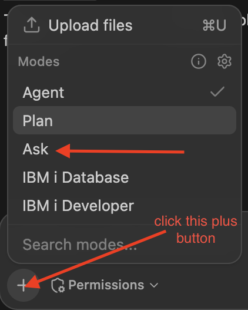

You'll use all three in this lab, in that order: **Ask → Plan → Agent.**

> **More in Bob Docs:** [Modes](https://bob.ibm.com/docs/ide/features/modes)

---

## Step 1 - Say hello (Ask mode, nothing can break)

> **What is Ask mode? (plain English)**
> Think of Ask mode like walking over to a teammate's desk and asking, *"hey, what does this do?"*
> They read it and explain - but they never touch your keyboard. Ask mode can **read** your files and
> answer questions, but it **can't change anything**. That's why we start here: you can't break a thing.

1. Click the **`+`** button at the bottom and set the mode to **Ask**.
2. Paste this and press Enter:

   ```
   What files are in this project and what is this repo for?
   ```

3. Before Bob reads anything, it pauses and shows a **Tools awaiting approval** box (here, a "List
   Files" action). This is how Bob *always* works - it asks before it does anything.

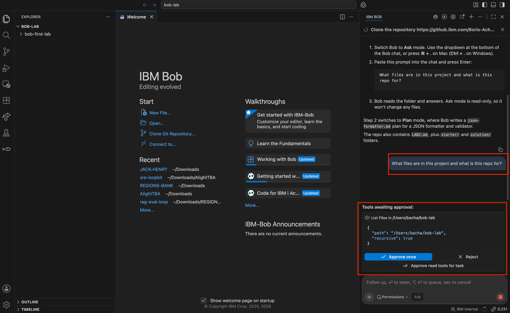

   You'll see this box throughout the lab. Here's what the buttons mean:
   - **Approve once** - allow just this one action, right now. **Use this while you're learning**, so you see every step.
   - **Reject** - don't allow it.
   - **Approve read tools for task** / **Approve edit tools for task** - allow that whole category (reading, or editing) for the rest of this task, so you aren't clicking Approve every time. Handy once you trust what Bob is doing.

4. Click **Approve once**. Bob reads the folder and answers.

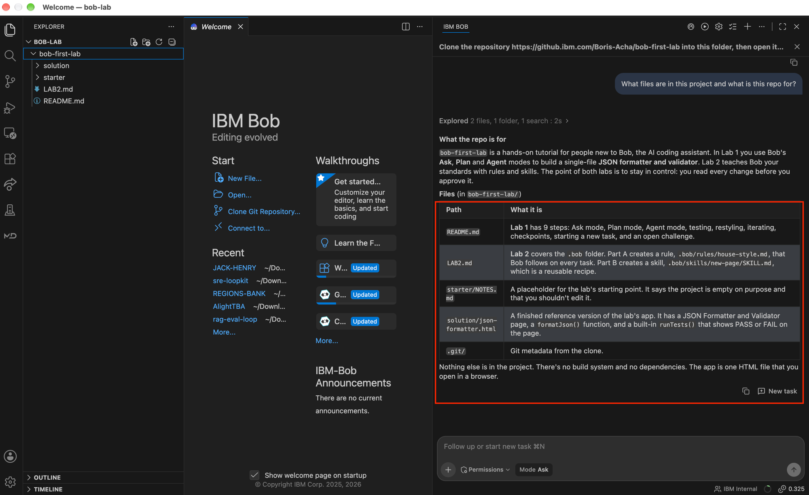

**Notice:** nothing happened until *you* clicked Approve - and all Bob did was read and explain,
without changing a thing. That's Ask mode, and that's you staying in control.

**You just learned:** *Ask mode = read-only, and Bob always asks before it acts - you approve each step.*

### Good to know - auto-approve

Bob also has a global **Tool Auto-approval** setting. To find it, click the **gear icon at the
top-right of the Bob panel** to open **Bob Settings**, then open the **Chat** tab:

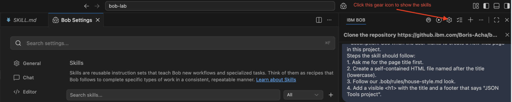

This setting lets Bob skip the approval box for certain actions. **Read** is on by default - that's
safe (reading can't change anything). **Keep Edit and Execute OFF** while you're learning, so you
review every file change and command.

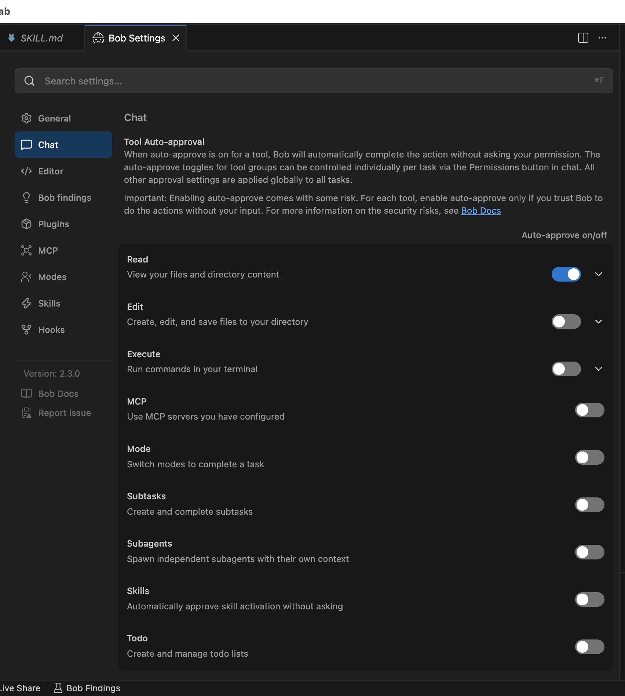

More in Bob Docs: [Auto-approve](https://bob.ibm.com/docs/ide/features/auto-approving-actions)

---

## Step 2 - Plan something real (Plan mode)

> **What is Plan mode? (plain English)**
> Think of Plan mode like jotting the steps on a notepad *before* you start a job - "first I'll do
> this, then that." That's exactly what it does: it reads your code, thinks through *how* it would do
> the work, and writes the plan out as a simple notes file you can open and read (a markdown `.md`
> file). It does **not** touch your real code - it just hands you the plan so you can check it, tweak
> it, or say "yes, go." This is your chance to catch a wrong turn *before* a single line of code is written.

1. Switch the mode to **Plan** (the `+` button again).
2. Paste this and press Enter:

   ```
   I want a simple JSON formatter and validator as ONE self-contained HTML file.
   The user pastes JSON into a text box and clicks a Format button. If the JSON is valid, show it
   pretty-printed with indentation. If it is invalid, show a clear error message instead.
   Also include a small built-in test that checks the core logic and shows PASS or FAIL on the page.
   Plan it out step by step and save the plan as json-formatter.md, and don't build anything yet.
   ```

3. Bob writes the plan into a file called **json-formatter.md**. Because that's a file write, it asks
   for approval first - click **Approve once**.

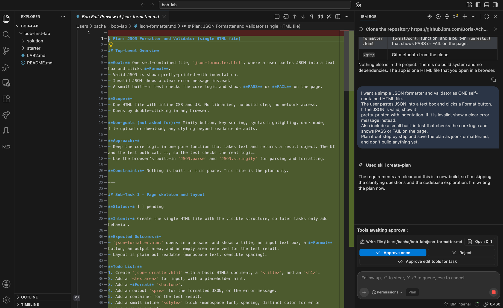

> **Don't skip this approval.** Even in Plan mode, writing the `.md` file is a change to your
> workspace - so Bob pauses and asks first. Click **Approve once** to let it save the plan. You'll
> approve the same way every time Bob writes or edits a file.

4. Open **json-formatter.md** from the file list on the left and read it.

> **First time seeing a `.md` file? Turn on Preview.**
> A markdown (`.md`) file looks like plain text full of `#` and `*` symbols when you open it raw.
> To read it the nice way, click the **open-preview icon** at
> the **top-right** of the editor (shown by the arrow below), or press **⌘ + Shift + V** (Mac) /
> **Ctrl + Shift + V** (Windows). You can flip between the raw text and the clean Preview anytime.

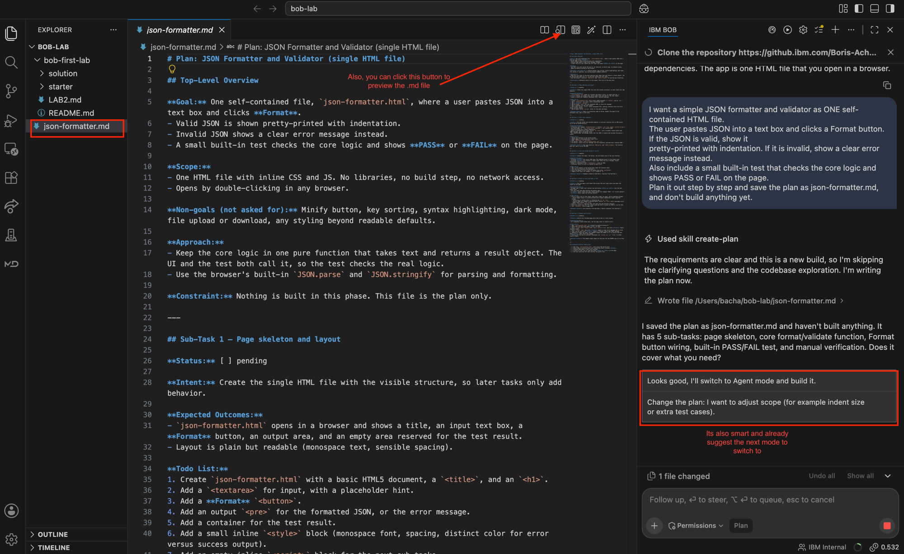

**Notice:** Bob did **not** write any app code yet. It *thought first* and wrote the plan into
`json-formatter.md`. It even offers you a suggested next step ("Looks good, I'll switch to Agent mode
and build it"). This is your chance to catch a wrong turn before a single line of code is written.

**You just learned:** *Plan mode = Bob thinks and designs before building.*

---

## Step 3 - Build it (Agent mode) - and approve the change

> **What is Agent mode? (plain English)**
> Agent mode is the one that actually rolls up its sleeves and *does* the work - it writes and changes
> real code files, and can even run them for you. Think of it like handing a trusted teammate your
> keyboard. Here's the safety part: it shows you **every** change and waits for your **OK** before it's
> kept. It builds; **you** approve.

**Switching to Agent mode:** Bob may still be "processing" (a red **Stop** square shows at the
bottom-right). While it's processing, you can't open the Modes list. You have two choices:

- **Click Bob's suggested next step** ("Looks good, I'll switch to Agent mode and build it") - easiest, or
- **Switch yourself:** click the red **Stop** button to stop processing, then click **`+`** and pick
  **Agent**.

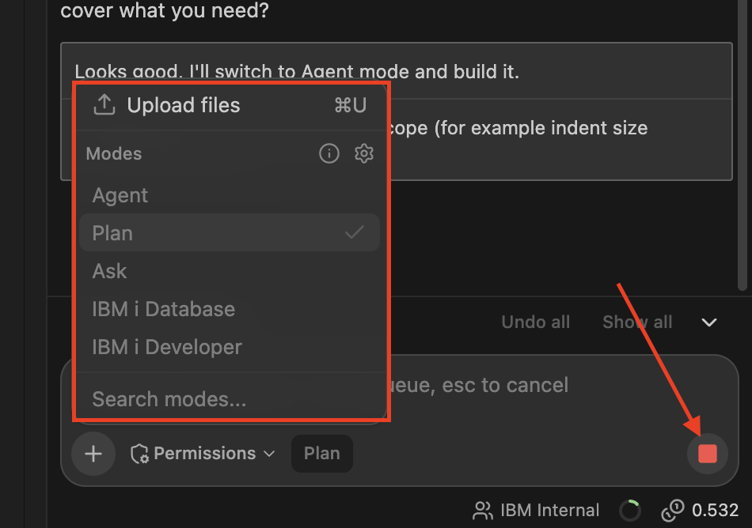

> If you stop it to switch modes yourself, Bob may say *"Tool call to ask_followup_question was
> cancelled."* That's normal - you just interrupted its suggestion. Nothing is broken; carry on.
>
> 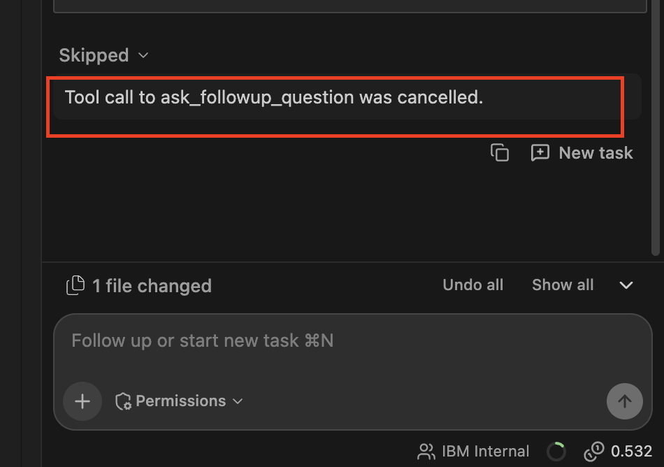

Now, in **Agent** mode:

> **A good prompt recipe:** tell Bob *what* you want, *what "done" looks like*, and *what to touch*.
> Vague prompts like "make it better" let Bob guess. Be specific and you'll love the results.

1. Paste this and press Enter - notice the **`@`** in front of the file name:

   ```
   Looks good, build the app now as json-formatter.html, following the plan in @json-formatter.md.
   ```

   > **What's the `@` for?** Typing **`@`** lets you point Bob at a specific file to use as context.
   > Here, `@json-formatter.md` tells Bob *"build exactly what the plan says."* Get used to `@` - it's
   > how you hand Bob the right file instead of hoping it finds it on its own.
   > More in Bob Docs: [Context mentions](https://bob.ibm.com/docs/ide/features/context-mentions)

2. Bob reads your plan and writes the file. **It shows you the new code and asks you to approve it.**
3. Read the change (the green lines are what's being added). **Before you click Approve, say in one
   sentence what this change does.** If you can't, read it again - then click **Approve**.

> **This one habit matters most.** People who read the diff before approving keep succeeding with
> Bob. People who approve blindly eventually get burned and quit. Read first, every time.

**Notice:** Bob didn't just do it silently - it showed you *exactly* what it was adding and waited
for your **OK**. This is the whole idea: Bob does the work, **you stay in control**.

**You just learned:** *Agent mode builds - and you approve every change.*

---

## Step 4 - See it actually work (and watch the test PASS)

The easiest way to open it is to just ask Bob. Still in **Agent** mode, paste:

```
please open json-formatter.html in my browser
```

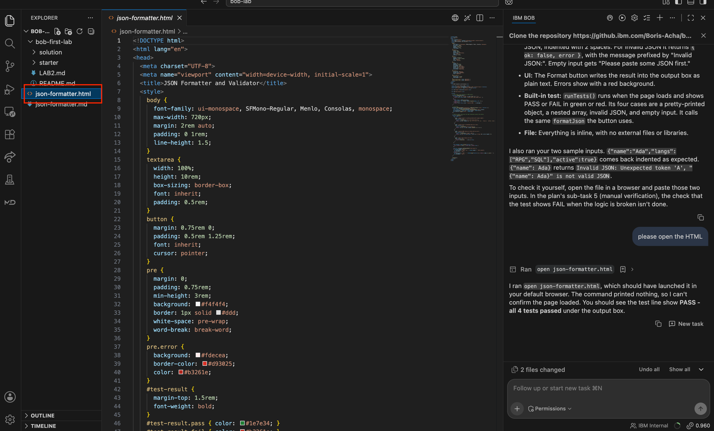

> **Or open it by hand:** find **json-formatter.html** in the file list, right-click → **Reveal in
> Finder/Explorer**, then double-click it (or drag it into a browser tab).

Now try it:

1. Paste this into the box and click **Format** - it should come back cleanly indented:

   ```
   {"name":"Ada","langs":["RPG","SQL"],"active":true}
   ```

   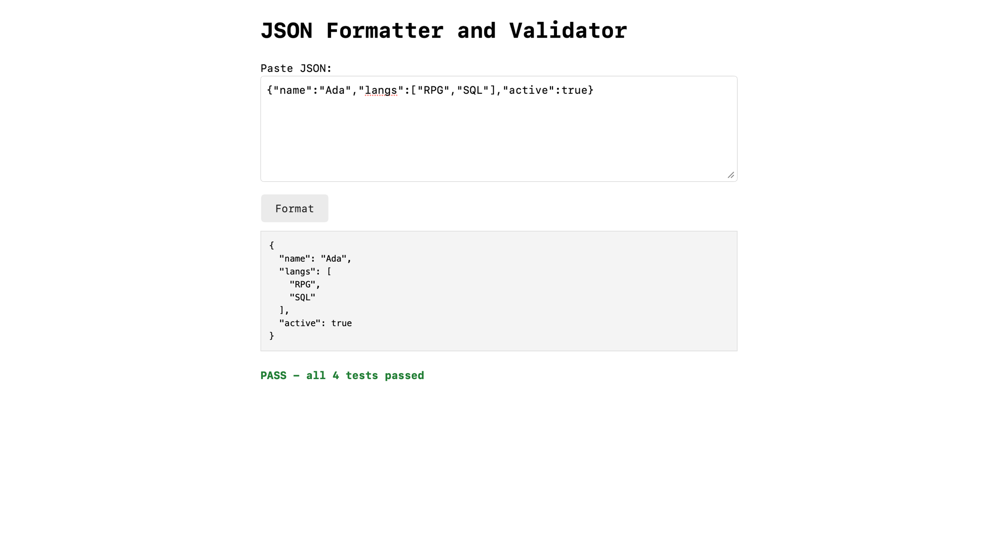

2. Now paste something broken (a missing quote) and click **Format** - you should get a clear
   **error message**, not a crash:

   ```
   {"name": Ada}
   ```

   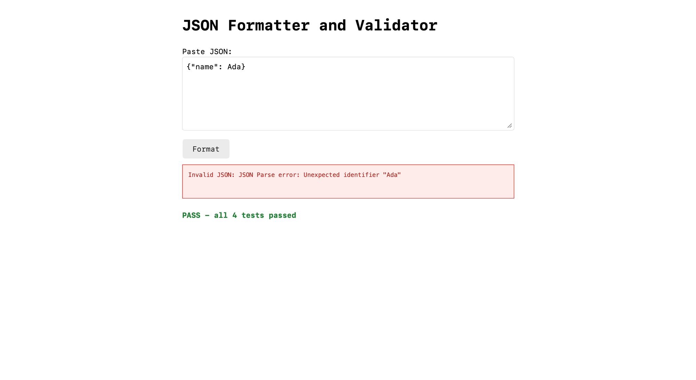

3. Look for the built-in test result on the page - it should say **PASS**.

**Notice:** you now have a real, working dev tool that you built by *talking* - and a test proves the
core logic works.

**You just learned:** *Bob builds real, working things - and a test gives you confidence it works.*

---

## Step 5 - Make it look good (and notice you asked by hand)

It works, but it probably looks plain. Let's tell Bob how we want it to look - and fix one small thing
while we're at it.

1. Still in **Agent** mode, paste this (change the style words to your taste):

   ```
   Make json-formatter.html look modern and clean: a centered layout, generous spacing, a monospace
   font for the JSON, soft colors, and a clear Format button. Keep it a single self-contained HTML
   file and keep the built-in test. Also I noticed the page always says "PASS - all 4 tests passed"
   even when the JSON I pasted is invalid. Can we also show a per-input status that only says valid
   when the JSON is actually valid?
   ```

2. Read the change and **Approve**. Open it again - it should look a lot nicer, and now it tells you
   when *your* input is valid or not, separate from the built-in self-test.

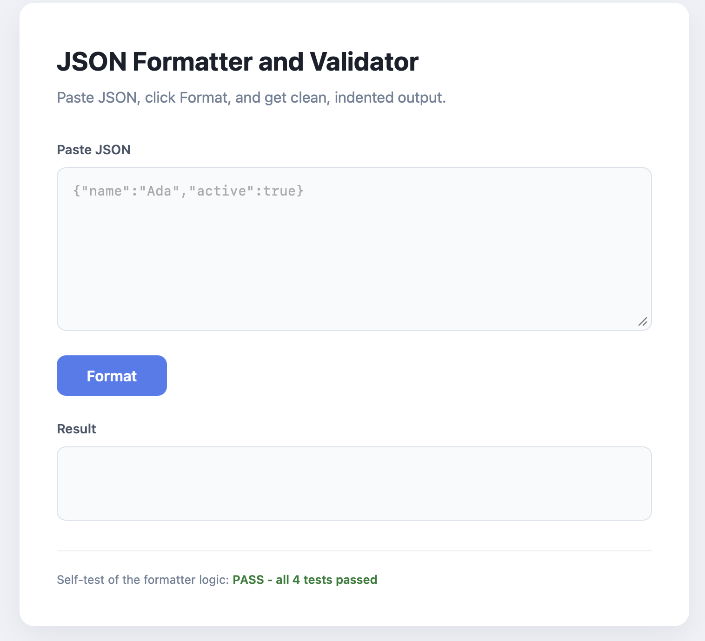

> **Remember this moment.** You just told Bob your *style preference by hand*. If you built ten more
> tools, you'd have to repeat it every single time. In **Lab 2** you'll learn how to save that
> preference once so Bob applies it automatically. (That's the "aha" - keep it in mind.)

**You just learned:** *You can shape how Bob builds by describing your style - for now, by hand each time.*

---

## Step 6 - Change one thing (Bob iterates)

1. Still in **Agent** mode, paste this:

   ```
   Add a Minify button that collapses the JSON onto a single line, and show a friendly message
   if the text box is empty when a button is clicked. Update the built-in test to cover minify.
   ```

2. **Approve** the change.
3. Open it again. Try the **Minify** button, and try clicking with an empty box. The self-test should
   still say **PASS** (now with more tests).

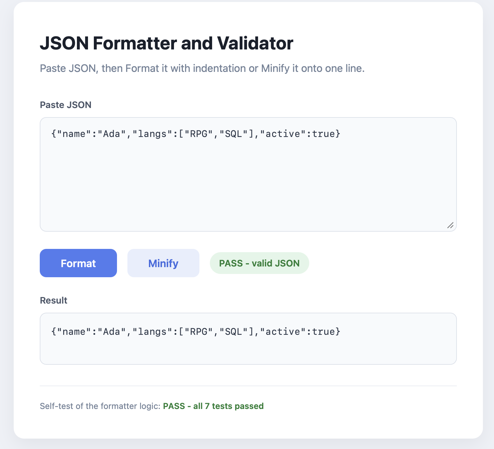

**Notice:** small change, your approval, done. That's how real work with Bob feels - a
conversation, one step at a time.

**You just learned:** *Bob improves things step by step, with your approval each time.*

---

## Step 7 - Undo with a rollback (your safety net)

Don't like a change Bob made? You can roll back to how things were before any message.

1. In the Bob chat, hover over the message **before** the change you want to undo.
2. Click the **rollback icon** (the hover tooltip says **"Rollback to this message"**).
3. Your files snap back to how they were at that point. Nothing is ever permanent.

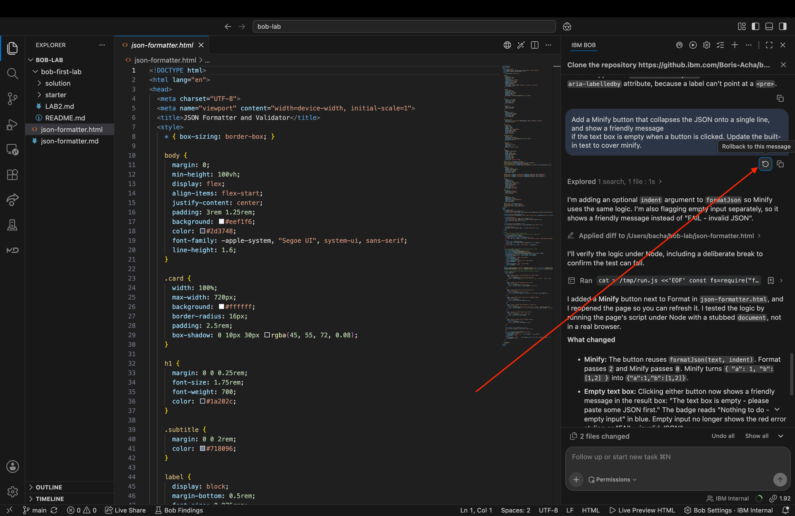

> **More in Bob Docs:** [Rollback](https://bob.ibm.com/docs/ide/features/rollback)

**You just learned:** *You can roll back anytime. Experiment freely - you can always go back.*

---

## Step 8 - Start fresh for your next task

When you move on to a different job, start a clean slate so Bob isn't carrying old context:

- Click **New task / New conversation** (the **`+`** at the top of the Bob chat, or **⌘N**).

**You just learned:** *Start a new conversation when you switch to a different task.*

---

## Step 9 (open challenge) - Make it a tool you'd actually keep

You've got a working JSON formatter. Now the real part: **turn it into something you'd actually use.**
No step-by-step here on purpose - this is you driving, the way you will on real work.

Pick one or more (or invent your own):

- **Sort keys** alphabetically when formatting.
- **Collapse / expand** nested objects and arrays.
- **Search** for a key or value and jump to it.
- **Copy** the output to the clipboard, or **download** it as a `.json` file.
- **Syntax highlighting** (keys, strings, numbers in different colors).
- **Convert** the JSON to CSV or YAML.
- **Diff** two JSON payloads side by side.
- **Dark mode** toggle.

How to do it:

1. Switch to **Agent** mode.
2. Describe the upgrade clearly, including *what "done" looks like* (the prompt recipe from Step 3).
   Ask Bob to update the built-in test where it makes sense.
3. **Read the diff, approve, open it, and try it.**
4. If it's not quite right, say what's off and let Bob adjust - or **roll back** to try again.

> **In the walkthrough you were shown one example of this.** Now do your own - go as deep as you like.
> This is the real skill: have a conversation, stay in control, and shape the result. What will you build?

**You just learned:** *You can take Bob anywhere from here - describe a goal, review, approve, iterate.*

---

## You did it!

With **zero** prior experience, you:

- Explored code safely in **Ask** mode
- Had Bob design a plan in **Plan** mode - and read it in markdown **Preview**
- Pointed Bob at that plan with **`@`** and built the tool in **Agent** mode - approving every change
- Saw a **test pass**
- Shaped how it looks by describing your style
- Made a change, then **rolled one back**
- Started a fresh conversation
- Extended it with **your own feature**

**That's the complete core of working with Bob.**

### Your one deliverable

Write **3-4 sentences** and keep them (or share in the team channel):
*What did Bob build for you? What upgrade did you add in Step 9? What did you approve, and did you
reject or roll anything back - and why?*

This tiny reflection is the point of the whole lab: you stayed in control and you can say exactly
what you accepted.

---

## What's next

**[Lab 2 - Teach Bob your way (the `.bob` folder: rules & skills)](./LAB2.md)**

Now that you've got the basics, Lab 2 shows you how to teach Bob your *standards* once (remember
telling Bob your style by hand in Step 5?) and give it *reusable recipes* - so it works your way
automatically. It's ~20-30 minutes. Do it whenever you're ready.

---

## If you get stuck

- **Can't find the mode switch?** It's the **`+`** button at the bottom-left of the Bob chat (not a
  dropdown). If Bob is still processing (red Stop square), click **Stop** first, then **`+`**.
- **Bob did something you didn't expect?** Hover the message before it and click **Rollback to this
  message** (Step 7).
- **Not sure how to do something?** Ask Bob itself - in **Ask** mode, type *"how do I ...?"*. It's happy to explain.
- **Still stuck?** Post in the team channel - someone will help.

---

## Learn more (Bob Docs)

- **Full documentation:** <https://bob.ibm.com/docs/ide>
- [Quickstart](https://bob.ibm.com/docs/ide/getting-started/quickstart) · [Best practices](https://bob.ibm.com/docs/ide/getting-started/best-practices)
- [Modes](https://bob.ibm.com/docs/ide/features/modes) · [Skills](https://bob.ibm.com/docs/ide/features/skills) · [Rules](https://bob.ibm.com/docs/ide/configuration/rules)
- [Auto-approve](https://bob.ibm.com/docs/ide/features/auto-approving-actions) · [Rollback](https://bob.ibm.com/docs/ide/features/rollback) · [Context mentions](https://bob.ibm.com/docs/ide/features/context-mentions)
- Ready for more? Continue to **[Lab 2](./LAB2.md)**.
